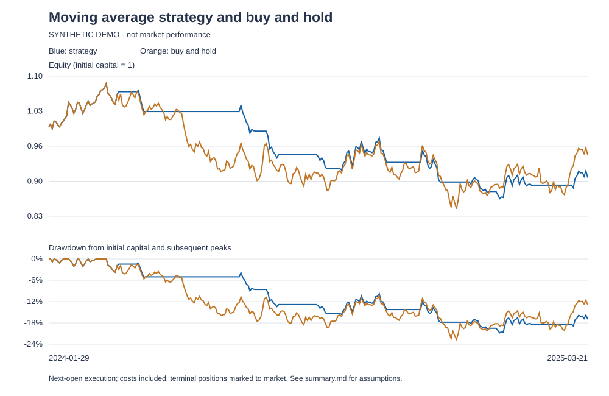

# A-share Moving Average Backtest
# A 股双均线策略回测

以 Python、pandas 和 NumPy 实现可核查的日频回测：行情校验、5/20 日均线信号、次日开盘执行、交易成本、买入持有基准，以及结果导出。真实行情下载可选使用 AKShare。

**项目重点：明确时间顺序与计算假设，让每一笔交易和每一个指标都能追溯。**

## 快速运行

建议使用 Python 3.11 或更高版本。在项目根目录执行：

```bash
python -m pip install -r requirements.txt
python -m src.run_research --demo
python -m unittest discover -s tests -v
```

无需行情接口即可运行演示。内置数据是固定随机种子生成的**合成测试样本**，不对应真实证券，演示收益不能用来判断策略效果。



## 使用真实 A 股行情

```bash
python -m pip install -r requirements-market.txt
python -m src.download_data --symbol 000001 --start 20200101 --end 20251231
python -m src.run_research --fast 5 --slow 20 --cost-bps 10
```

默认 CSV 保存于项目内的 `data/daily.csv`。下载时同时记录标的、复权口径、查询日期和数据源版本。
也可传入自己的 CSV（至少包含 `date,open,close`）：

```bash
python -m src.run_research --data data/daily.csv --start 2022-01-01 --end 2025-12-31 --output outputs/ping_an
```

`--start` 前的数据仍用于均线预热。程序不会静默填补缺失价格；重复日期、无效价格和不一致的 OHLC 会报错。
原有 `python src/download_data.py` 和 `python src/run_research.py` 入口也可使用，默认路径不依赖启动位置。

## 策略与成交约定

| 项目 | 实现 |
|---|---|
| 信号 | 5 日均线 > 20 日均线时持有，否则空仓；窗口可配置 |
| 成交时间 | t 日收盘信号，在 t+1 日开盘执行 |
| 持仓 | 只做多，全仓或现金；不使用杠杆 |
| 成本 | 每次买卖扣除可配置的单边成本，默认 10 bps 为示例假设 |
| 基准 | 同一评价区间的买入持有策略，起始开盘买入并扣除相同成本 |
| 期末 | 按最后收盘价计价，不强制平仓 |
| 指标 | 累计收益、年化收益、年化波动率、夏普比率、最大回撤、持仓比例和交易次数 |

逐日收益分为“原持仓承担的隔夜收益”和“开盘调仓后的日内收益”。最大回撤包含初始本金，避免漏掉第一次下跌。
完整公式、复权口径和限制见 [回测方法](docs/methodology.md)。

## 输出文件

一次运行生成五个文件，默认位于 `outputs/`：

| 文件 | 内容 |
|---|---|
| `daily.csv` | 价格、均线、信号、仓位、换手、成本、净收益、净值和回撤 |
| `trades.csv` | 买卖日期、开盘参考价、仓位变化和成本率 |
| `metrics.json` | 策略与基准指标、参数、数据校验和及运行环境版本 |
| `summary.md` | 可阅读的结果表及关键假设 |
| `performance.svg` | 净值与回撤对比图，可在浏览器直接查看 |

已提交的 [演示报告](examples/demo_output/summary.md) 使用合成数据，仅用于复现代码流程。真实行情结果需使用本地数据重新生成。

## 验证覆盖

标准库 unittest 测试覆盖：手工核算的交易收益、次日开盘成交、买卖成本、未来价格不影响过去结果、
相同评价区间、初始亏损回撤、零波动率夏普比率、无效数据拒绝、输入不被修改和跨工作目录运行。
可用以下命令重新生成合成样本与报告：

```bash
python examples/generate_synthetic.py
python -m src.run_research --demo --output examples/demo_output
```

## 项目结构

```text
src/
  data.py             # 数据读取与校验
  download_data.py    # AKShare 下载及来源记录
  features.py         # 均线与信号
  backtest.py         # 次日开盘执行与收益计算
  metrics.py          # 绩效指标
  report.py           # Markdown 和 SVG 报告
  run_research.py     # 命令行入口
tests/                # 可手工核验的回归测试
examples/             # 合成测试数据与完整示例输出
docs/methodology.md   # 公式、假设与研究限制
```

## 研究边界

这是学习与研究项目。它使用连续比例仓位，不模拟整手、最低佣金、成交量、涨跌停或完整交易所规则；
现金收益设为零。前复权行情也不等同于严格的历史时点数据。单标的、单参数结果不足以证明策略有效，
进一步研究应固定参数并使用多标的和独立样本。项目不提供投资建议。

## English overview

A compact, auditable daily A-share moving-average backtest. Signals formed at the close execute at the next session's open.
The engine separates overnight and intraday returns, applies configurable one-way costs, and compares against buy-and-hold
over identical dates. It exports daily and trade ledgers, metrics with input hashes, and equity/drawdown charts.
Offline examples use clearly labeled synthetic data. See the methodology for assumptions and limitations.
